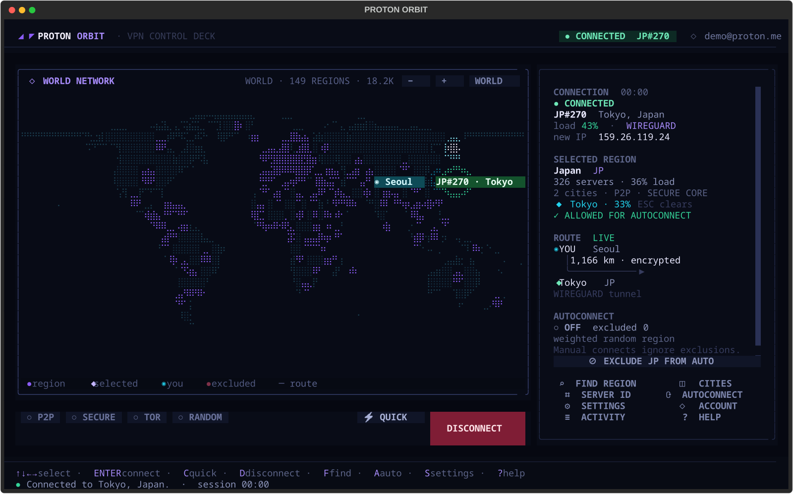
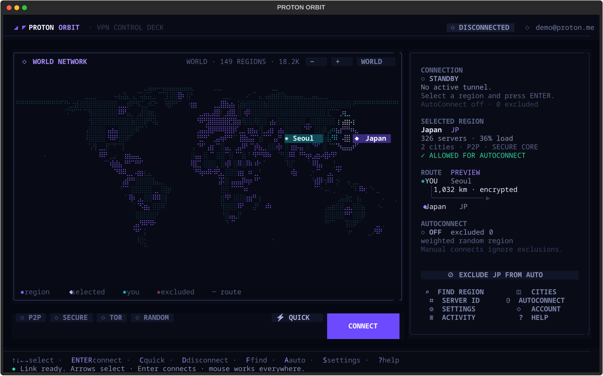
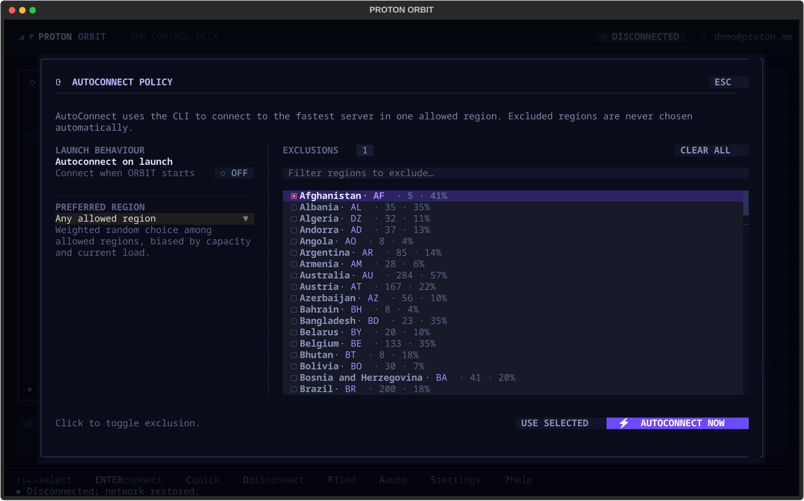
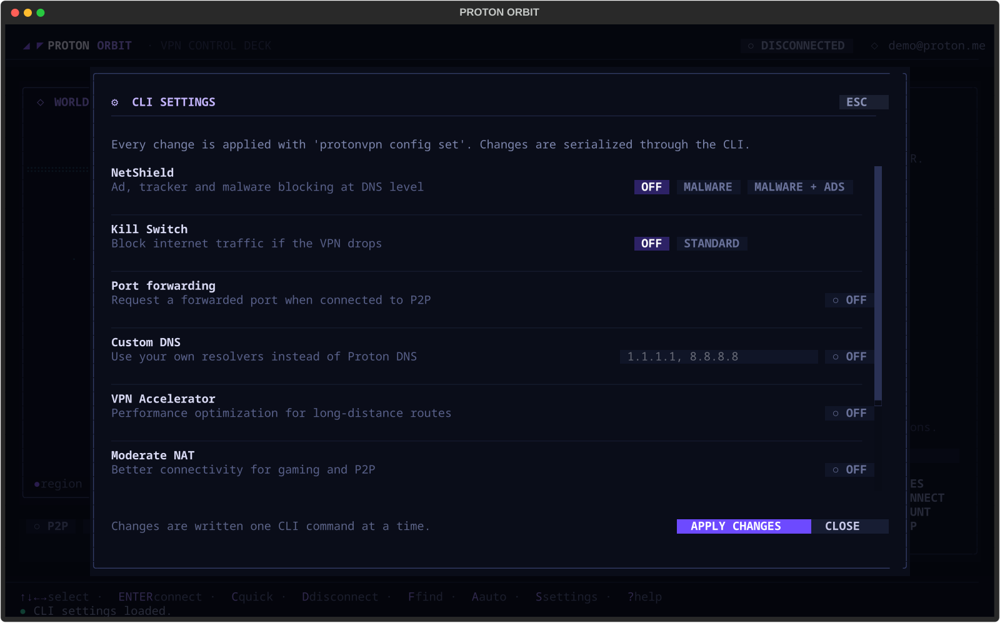

# Proton Orbit — ProtonVPN TUI

**Центр управления ProtonVPN в терминале.** Один Python-файл, интерактивная карта мира, подключение мышью или стрелками и анимированные маршруты от вашей точки до сервера.

[](https://www.python.org/)
[](https://textual.textualize.io/)
[](https://protonvpn.com/support/official-linux-client/)

<p align="center">
  
</p>

> **Важно для существующих пользователей ProtonVPN CLI:** если вы уже авторизованы, не выполняйте `protonvpn signout` без необходимости. Это особенно критично, если у вас нет доступа к 2FA и вы не сможете войти повторно. Proton Orbit никогда не запрашивает и не хранит ваш пароль или 2FA-код. Все операции входа и выхода выполняет официальный CLI.

---

## Возможности

- **Карта мира** — 149 регионов на braille-карте, проекция Робинсона, без внешних map-сервисов.
- **Мышь и клавиатура** — выбор региона кликом, стрелками, поиск по названию, коду или континенту.
- **Красивые маршруты** — анимированные дуги «вы → сервер», превью до подключения, live-маршрут, Secure Core из двух сегментов.
- **Все основные команды CLI** — `connect`, `disconnect`, `status`, `info`, `servers`, `countries`, `cities`, `config`, `signin`, `signout`.
- **Все 8 настроек CLI** — NetShield, Kill Switch, Port Forwarding, Custom DNS, VPN Accelerator, Moderate NAT, IPv6, Anonymous Crash Reports.
- **AutoConnect** — подключение при запуске, предпочитаемый регион, взвешенный выбор по ёмкости/нагрузке и **Exclude Regions from Autoconnect**.
- **Города и Server ID** — подключение к конкретному городу (`--city`) или логическому серверу (`JP#23`).
- **Лог CLI** — каждая команда и её сырой вывод доступны в экране Activity.
- **Адаптивность** — от 80×24 до широких терминалов; на узких экранах боковая панель скрывается, все разделы остаются доступны с клавиатуры.

### Скриншоты

<p align="center">
  
  
</p>
<p align="center">
  
  
</p>

*Скриншоты сделаны с демонстрационным аккаунтом и тестовым CLI. Реальные учётные данные в репозитории отсутствуют.*

---

## Требования

| Компонент | Версия |
|---|---|
| Linux | официальный ProtonVPN Linux client |
| Python | 3.10+ |
| `protonvpn` CLI | 1.0.x, установлен и доступен в `PATH` |
| Textual | 8.x |
| Rich | 13+ |
| Терминал | рекомендуется 100×30; минимум 80×24 |

Установите официальный ProtonVPN Linux client по [инструкции Proton](https://protonvpn.com/support/official-linux-client/). CLI должен отвечать:

```bash
protonvpn --help
protonvpn status
```

Если вы уже вошли в аккаунт — **ничего не делайте с входом**. Orbit читает состояние через `protonvpn info` и `protonvpn status`.

---

## Установка

```bash
git clone https://github.com/mikhailfur/protonvpn-orbit-tui.git
cd protonvpn-orbit-tui

python3 -m venv .venv
source .venv/bin/activate
pip install -r requirements.txt

python3 proton_orbit.py
```

Или сделайте файл исполняемым:

```bash
chmod +x proton_orbit.py
./proton_orbit.py
```

Если CLI установлен в нестандартном месте:

```bash
PROTONVPN_BIN=/path/to/protonvpn python3 proton_orbit.py
```

---

## Настройка

### Авторизация

TUI не перехватывает пароль и не хранит секреты. Вход и выход выполняет официальный `protonvpn` CLI в отдельном терминальном режиме.

- Если CLI уже авторизован, просто запускайте Orbit.
- Если нет — откройте экран **ACCOUNT** (`I`) и используйте **SIGN IN VIA CLI**. Пароль и 2FA вводятся в терминале CLI.
- Существующую сессию можно не трогать: `status` и `info` работают только на чтение.

> Не запускайте `protonvpn signout`, если потеряли доступ к 2FA и не сможете войти снова.

### Настройки ProtonVPN

Экран **SETTINGS** (`S`) читает `protonvpn config list` и применяет изменения через `protonvpn config set`:

| Настройка | Значения |
|---|---|
| NetShield | `off`, `malware-only`, `malware-ads-trackers` |
| Kill Switch | `off`, `standard` |
| Port Forwarding | `off`, `on` |
| Custom DNS | `off`, `on --dns 1.1.1.1,8.8.8.8` |
| VPN Accelerator | `off`, `on` |
| Moderate NAT | `off`, `on` |
| IPv6 | `off`, `on` |
| Anonymous Crash Reports | `off`, `on` |

Kill Switch блокируется в интерфейсе, пока активно подключение. Custom DNS и IPv6 применяются к следующему подключению.

### Источник маршрута

Источник определяется по системной timezone (`/etc/timezone`) и показывается на карте и в карточке маршрута. На экране **ACCOUNT** можно:

- **USE TIMEZONE** — сбросить на системную timezone.
- **REFINE VIA IP** — один раз запросить `ipinfo.io`, чтобы уточнить город. Запрос выполняется только по нажатию, никогда автоматически.

Источник влияет только на отрисовку маршрута и не используется для VPN-подключения.

### AutoConnect и исключения регионов

Экран **AUTOCONNECT** (`A`):

- **Autoconnect on launch** — подключаться при старте Orbit.
- **Preferred region** — всегда выбирать этот регион, если он разрешён.
- **Any allowed region** — взвешенный random по разрешённым регионам с учётом количества серверов и нагрузки.
- **Exclusions** — регионы, которые AutoConnect не должен выбирать. Исключения не влияют на ручные подключения.
- **AUTOCONNECT NOW** — выполнить выбор и подключиться через CLI.

Exclusions сохраняются сразу. Те же настройки доступны по `E` (с фокусом на поиске исключений).

### Файлы

```text
~/.config/protonvpn-tui/config.json    # AutoConnect, exclusions, source, filters
~/.cache/protonvpn-tui/server_index.json
~/.cache/Proton/VPN/serverlist.json    # читается только для статистики и городов
```

Конфиг создаётся атомарно с правами `600`. Пароль, 2FA и токены в нём не хранятся.

---

## Клавиши

| Клавиша | Действие |
|---|---|
| `↑ ↓ ← →` | Выбрать ближайший регион в направлении |
| `Enter` | Подключиться к выбранному региону/городу |
| `C` | Quick Connect: самый быстрый сервер |
| `D` | Отключиться |
| `F` | Поиск региона |
| `X` | Города выбранного региона |
| `V` | Подключение по Server ID |
| `A` / `E` | AutoConnect / исключения |
| `S` | Настройки CLI |
| `I` | Аккаунт и источник |
| `L` | Activity: команды и вывод CLI |
| `?` | Помощь |
| `P` `U` `T` `R` | P2P / Secure Core / Tor / Random |
| `+` `-` `0` | Zoom in / out / reset |
| `Esc` | Закрыть модальное окно; на карте — сбросить город/зум |
| `Q` | Выход |
| Мышь | Клик по региону, двойной клик — подключение, колесо — зум |

---

## Соответствие CLI

| CLI | В Orbit |
|---|---|
| `protonvpn signin` / `signout` / `info` | ACCOUNT |
| `protonvpn connect` | ENTER / QUICK / SERVER ID |
| `protonvpn connect --country` | выбор региона на карте |
| `protonvpn connect --city` | CITIES |
| `protonvpn connect --p2p/--securecore/--tor/--random` | фильтры P2P / SECURE / TOR / RANDOM |
| `protonvpn disconnect` / `status` | D / фоновый polling |
| `protonvpn servers` | ACCOUNT → ссылка |
| `protonvpn countries list` | загрузка каталога при старте |
| `protonvpn cities list` | CITIES |
| `protonvpn config list` / `config set` | SETTINGS |

Orbit не реализует VPN-логику заново: все изменения состояния, туннель, конфиг и авторизация проходят через установленный CLI.

---

## Как это устроено

- Один файл `proton_orbit.py`; только `textual`, `rich` и стандартная библиотека Python.
- Встроенная география Natural Earth 110m: контуры суши и координаты стран; границы специально отключены на мировом масштабе.
- Проекция Робинсона, braille-рендеринг и ручная отрисовка маршрутов/маркеров.
- CLI-вызовы сериализуются через один lock; фоновый polling статуса не спамит лог.
- Серверный индекс из официального кеша Proton обогащает карту количеством серверов, нагрузкой, городами и фичами.
- AutoConnect сначала выбирает разрешённый регион, затем просит CLI самый быстрый сервер внутри него.

---

## Известные ограничения и roadmap

Актуальные задачи ведутся в [GitHub Issues](https://github.com/mikhailfur/protonvpn-orbit-tui/issues). В частности:

- экран входа требует дополнительной проверки после реального `signin`;
- нужна проверка платных режимов Secure Core/Tor/P2P на реальном аккаунте;
- на 80×24 Settings и Account требуют прокрутки;
- автоматических UI-тестов пока нет.

Если вы уже авторизованы и не хотите рисковать сессией, не используйте sign-out и тестируйте account-flow только на отдельном тестовом аккаунте.

---

## Лицензия

MIT. См. [LICENSE](LICENSE).
